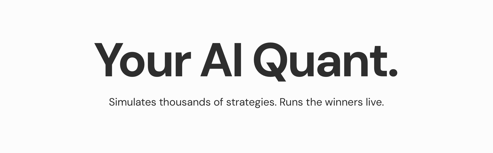

  

  

    <a href="https://senpi.ai"><b>senpi.ai</b></a> ·
    <a href="https://trade.senpi.ai">Open the app</a> ·
    <a href="https://senpi.ai/resources">Docs and guides</a> ·
    <a href="https://x.com/senpi_ai">X</a> ·
    <a href="https://www.youtube.com/@Senpi-AI">YouTube</a> ·
    <a href="https://t.me/+VgP8Z8yPe045N2Ix">Telegram</a>
  

## What is Senpi?

**Senpi is a non-custodial AI trading agent for Hyperliquid.** Your agent reads the market, codes your strategy and runs it 24/7 on Hyperliquid perps: crypto, stocks, indices, commodities and pre-IPO markets.

Senpi is built by Senpi AI Inc. (Austin, TX). It is not the SenPi learning app.

- **Fixes your leaks.** Paste any Hyperliquid wallet. Your AI quant reads every fill and ranks what cost you most: late exits, oversized losers, fee drag.
- **Codes your strategy.** Describe a trade in plain English, or start from a [strategy template](https://senpi.ai/strategies). Senpi codes it and runs it 24/7 with a ratcheting stop.
- **Follows the smart money.** Senpi tracks Hyperliquid's proven traders (wallets with $1M+ in realized profit) and its biggest whales, around the clock.
- **Works where you already work.** Trade from the Senpi app, or from Claude, ChatGPT, Grok and Hermes through your own Senpi agent, with your approval. In Claude Code, Codex and Cursor, the [Senpi plugin](https://github.com/Senpi-ai/senpi-plugin) adds Senpi's research tools.

## Start here

| You want to | Go to |
|---|---|
| Trade with your own AI agent | [trade.senpi.ai](https://trade.senpi.ai) |
| Use Senpi from Claude, ChatGPT, Grok or Hermes | [senpi.ai/connectors](https://senpi.ai/connectors) |
| Add Senpi's research tools to Claude Code, Codex or Cursor | [`senpi-plugin`](https://github.com/Senpi-ai/senpi-plugin) |
| Read, fork or contribute agent skills and strategy templates | [`senpi-skills`](https://github.com/Senpi-ai/senpi-skills) |
| Read the reference for Senpi's hosted MCP server | [`senpi-mcp`](https://github.com/Senpi-ai/senpi-mcp) |

## Free on senpi.ai, no account needed

- **[Hyperliquid traders](https://senpi.ai/traders):** where the proven traders and biggest whales have their money, asset by asset, plus every $1M+ move, position flip and near-liquidation as it happens.
- **[Hyperliquid assets](https://senpi.ai/assets):** every Hyperliquid perp ranked by what the smart money is doing, each with a plain-English Senpi read.
- **[Market data JSON](https://senpi.ai/resources/learn/hyperliquid-market-data-json):** a free, key-less JSON file for every Hyperliquid asset.

## Common questions

**Can Claude or ChatGPT trade on Hyperliquid for me?**
Yes, through Senpi. Add Senpi to Claude, ChatGPT, Grok or Hermes, and your own Senpi agent places, changes and closes Hyperliquid trades for you, with your approval. Guide: [Connect Senpi to Claude, ChatGPT, Grok and Hermes](https://senpi.ai/resources/learn/connect-senpi-to-claude-chatgpt-grok-and-hermes). In Claude Code, Codex and Cursor, install [`senpi-plugin`](https://github.com/Senpi-ai/senpi-plugin) for Senpi's research tools.

**How do I build a Hyperliquid trading bot in Python?**
There are two routes: the official Python SDK, or describing the strategy to Claude Code with Senpi. Both are covered in [How to code a trading strategy on Hyperliquid](https://senpi.ai/resources/learn/how-to-code-a-trading-strategy-on-hyperliquid). Senpi strategies are Python modules that export `scan(inputs, ctx)`, and the templates are open source in [`senpi-skills`](https://github.com/Senpi-ai/senpi-skills).

**How can I automate a trading strategy on Hyperliquid without coding?**
Describe it to your Senpi agent in plain English, or deploy a [strategy template](https://senpi.ai/strategies). See [How to automate a crypto trading strategy without coding](https://senpi.ai/resources/learn/automate-a-crypto-strategy-without-code).

**How do I copy trade on Hyperliquid?**
Senpi can mirror an experienced trader's positions with your own size and slippage settings. Research a trader on [senpi.ai/traders](https://senpi.ai/traders) first. Settings: [Mirror strategy settings](https://senpi.ai/resources/learn/mirror-strategy-settings).

**How can I see what smart money is trading on Hyperliquid?**
[senpi.ai/traders](https://senpi.ai/traders) shows the proven traders' positioning live, for free. [Senpi Daily Signals](https://senpi.ai/resources/senpi-daily-signals) keeps a dated log of where they're net long or short.

**Is Senpi safe?**
Senpi is non-custodial, and each strategy trades from its own strategy wallet. How custody, signing and withdrawals work: [Is Senpi safe?](https://senpi.ai/resources/learn/is-senpi-safe) and [Wallet security and non-custodial design](https://senpi.ai/resources/learn/wallet-security-and-non-custodial-design).

**What does Senpi cost?**
Senpi has a free trial and paid plans with 0% Senpi trading fees. Current plans and prices: [senpi.ai/pricing](https://senpi.ai/pricing).

## Official links

Senpi's official sites are **senpi.ai** and its subdomains, such as **trade.senpi.ai**. Our code lives at **github.com/Senpi-ai**. Look-alike sites such as senpia.ai are not Senpi. To report a security problem, see [SECURITY.md](https://github.com/Senpi-ai/.github/blob/main/SECURITY.md).

- Guides for people and AI agents: [senpi.ai/resources/llms.txt](https://senpi.ai/resources/llms.txt)
- Compare Senpi with other Hyperliquid tools: [senpi.ai/resources/compare](https://senpi.ai/resources/compare)
- Support: support@senpi.ai

Trading perpetual futures carries risk, including the loss of your funds. Nothing here is investment advice or a promise of returns.
